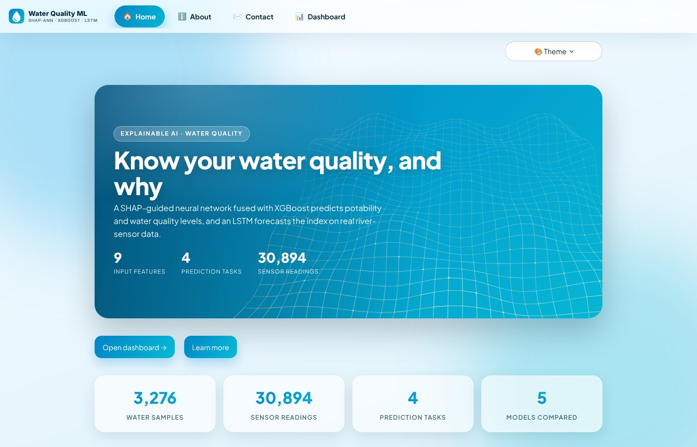
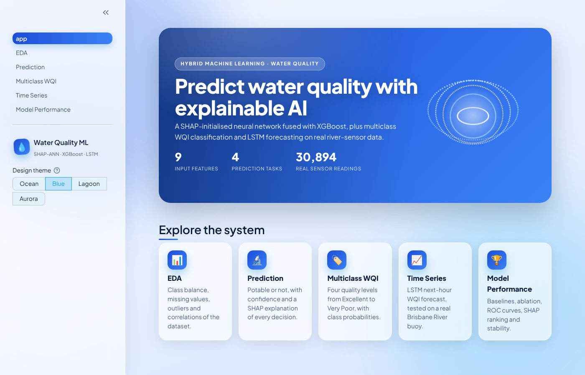
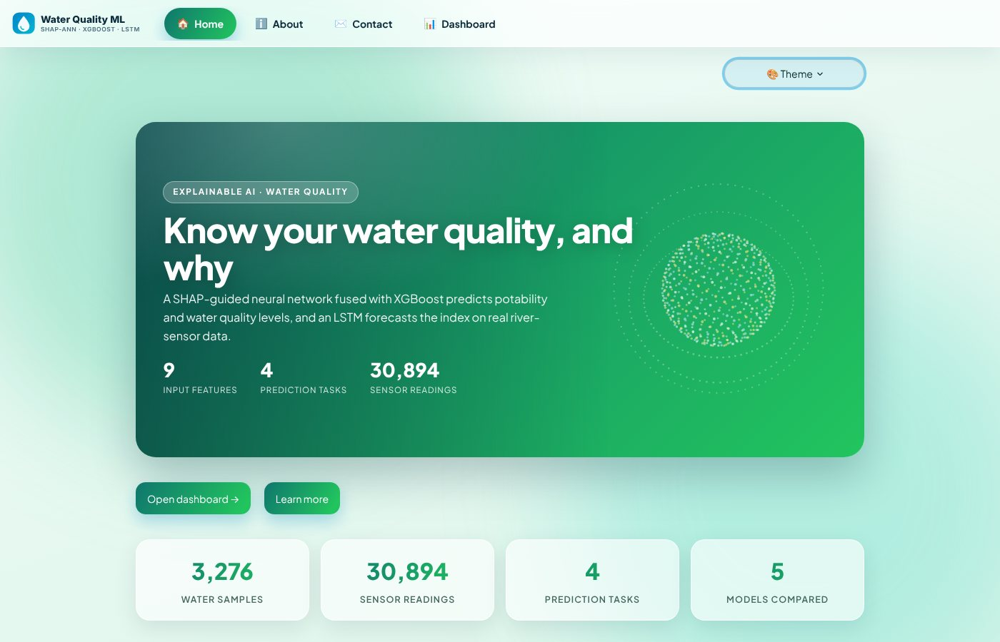
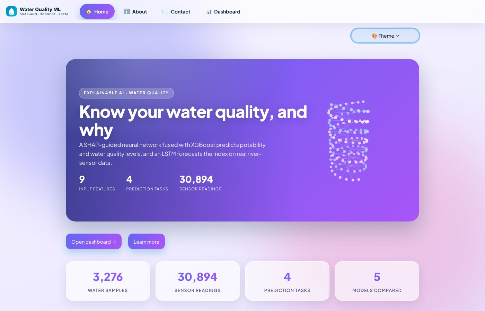
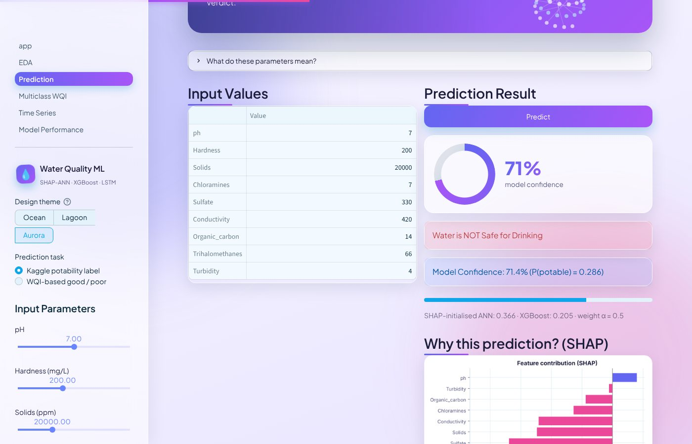
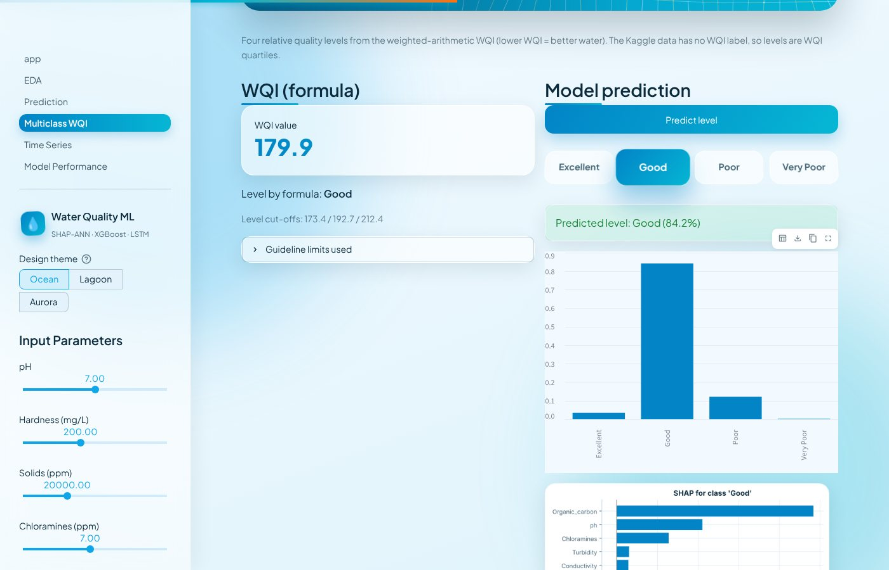
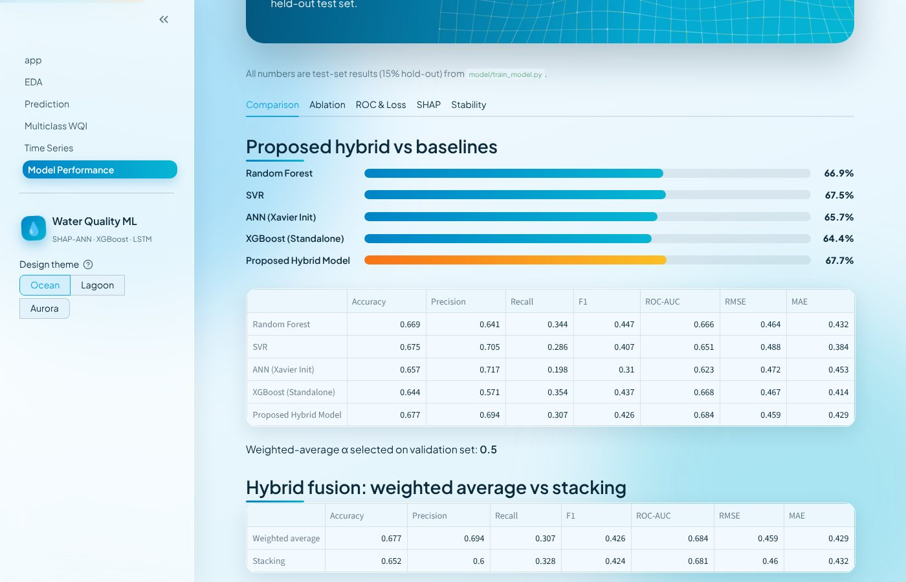

# Water Quality Prediction

[](https://www.python.org/downloads/)
[](https://streamlit.io/)
[](LICENSE)

An end-to-end machine learning project for water quality: a **hybrid framework (SHAP-initialised neural network + XGBoost)** for potability prediction, **multiclass WQI classification**, and **LSTM time-series forecasting**, with an interactive Streamlit app.

---

## Overview

This project combines machine learning, data preprocessing, feature engineering, and an interactive web interface to analyze water quality and predict potability in real time.

Implements the method of *Al Bataineh, Vamsi & Smith, "A Hybrid Machine Learning Framework for Water Quality Index Prediction Using Feature-Based Neural Network Initialization", IEEE JSTARS 19, 2026* and its multiclass / time-series extensions.

---

## Live Demo:
[Click here to view the Live Demo](https://water-quality-prediction-ml-eykh9eeqjxvj3gpzxurkmz.streamlit.app)

---

# Video Demo:

<video src="https://github.com/user-attachments/assets/f27c891d-3cc5-4558-a622-913d3e0d7797" width="100%" controls></video>

---

## Methods

| Task | Model |
|---|---|
| Potable / not potable | ANN (9-16-8-1, ReLU, dropout 0.2, Adam 1e-3) whose first-layer weights are scaled by normalised SHAP importance + XGBoost, fused by weighted average (alpha chosen on validation set from 0.3-0.7); stacking also available |
| Multiclass WQI (4 levels) | Same SHAP-initialised ANN (softmax) + XGBoost (multi:softprob) |
| Time series | LSTM (64 units) predicting the next-hour WQI from the last 24 hours, on **real** Brisbane River buoy data |

**Pipeline (no data leakage):** stratified 70/15/15 split first, then median imputation and min-max scaling fitted on the training part only. Early stopping (patience 10) on validation loss.

**SHAP initialisation:** an XGBoost model gives mean |SHAP| per feature, normalised to W_i = FI_i / sum(FI) (paper Eq. 3). Row i of the Glorot-initialised first-layer kernel is multiplied by 9 * W_i, so important features start with larger weights. The only difference to the Xavier baseline is this scaling (same seed).

## Results (test set, 15% hold-out, seed 42)

Potability (binary):

| Model | Accuracy | Precision | Recall | F1 | ROC-AUC | RMSE | MAE |
|---|---|---|---|---|---|---|---|
| Random Forest | 0.669 | 0.641 | 0.344 | 0.447 | 0.666 | 0.464 | 0.432 |
| SVR | 0.675 | 0.705 | 0.286 | 0.407 | 0.651 | 0.488 | 0.384 |
| ANN (Xavier Init) | 0.657 | 0.717 | 0.198 | 0.310 | 0.623 | 0.472 | 0.453 |
| XGBoost (Standalone) | 0.644 | 0.571 | 0.354 | 0.437 | 0.668 | 0.467 | 0.414 |
| Proposed Hybrid Model | 0.677 | 0.694 | 0.307 | 0.426 | 0.684 | 0.459 | 0.429 |

Ablation:

| Variant | Accuracy | Precision | Recall | F1 | ROC-AUC | RMSE | MAE |
|---|---|---|---|---|---|---|---|
| ANN (Xavier Init) | 0.657 | 0.717 | 0.198 | 0.310 | 0.623 | 0.472 | 0.453 |
| ANN (SHAP Init) | 0.679 | 0.774 | 0.250 | 0.378 | 0.661 | 0.465 | 0.444 |
| ANN (Xavier Init + Boosting) | 0.663 | 0.681 | 0.255 | 0.371 | 0.671 | 0.463 | 0.437 |
| Proposed Hybrid Model (Final) | 0.677 | 0.694 | 0.307 | 0.426 | 0.684 | 0.459 | 0.429 |

- Weighted average alpha = 0.5. Stability over 5 random splits: accuracy 0.672 ± 0.021, F1 0.406 ± 0.077.
- **These numbers are lower than the paper's (86.9% accuracy, AUC 0.894).** On this dataset the hybrid is the best model by accuracy and AUC here, but the margins are small and within the split-to-split variation above. The paper's higher numbers could not be reproduced with a leakage-free protocol. The paper's Table V weights also sum to 1.079, which contradicts its Eq. 3; this code uses Eq. 3.
- The previous version of this repo reported 71% using SMOTE and scaling *before* the split (leakage); it has been removed.

WQI-based good / poor task (second binary task, `python model/train_model.py --task wqi`): label = 1 if the computed WQI is at or below the dataset median (50% positive), else 0.

| Model | Accuracy | F1 | ROC-AUC |
|---|---|---|---|
| Random Forest | 0.941 | 0.942 | 0.989 |
| SVR | 0.949 | 0.949 | 0.990 |
| ANN (Xavier Init) | 0.967 | 0.967 | 0.996 |
| XGBoost (Standalone) | 0.959 | 0.960 | 0.995 |
| Proposed Hybrid Model | 0.978 | 0.978 | 0.997 |

- Hybrid accuracy **0.978**, 5 random splits 0.965 ± 0.007. This is far above the paper's 86.9% and **not comparable** to the potability task: the label is a formula of the same 9 inputs (any good model can learn it) and has almost no correlation with the Kaggle label (about -0.04). Use it only as a separate, clearly labelled task. In this task SHAP initialisation does not beat Xavier on its own (0.963 vs 0.967); the boosting step gives the gain.
- The paper's Table X shows continuous "WQI class" values, which suggests the paper may have predicted a WQI-type label rather than the Kaggle one. This is a guess; the paper does not say how its WQI was built.

Multiclass WQI (4 balanced levels): hybrid accuracy 0.907, macro-F1 0.907 (ANN only 0.878, XGBoost only 0.868).

**Important notes**
- The Kaggle dataset has **no WQI column**. WQI is computed with the weighted-arithmetic method (`src/wqi.py`, WHO/EPA-style limits). Nearly all samples exceed the limits, so fixed cut-offs would give a single class; the four levels are WQI **quartiles** (relative levels). Since labels are a function of the same 9 features, high accuracy is expected and not comparable to the potability task.
- The potability dataset has **no time column**, so the LSTM uses a second, **real** dataset: the Brisbane River water-quality buoy (30,894 readings every 10-30 min, Aug 2023 - Jun 2024; Queensland Government Open Data via Kaggle, Apache-2.0; `data/brisbane_river_water_quality.csv`). It is cleaned (sorted, 280 duplicate timestamps averaged, suspect-flag values masked, short gaps interpolated) and resampled to hourly means (6,229 steps). A WQI is computed from pH, dissolved oxygen, turbidity and chlorophyll (approximate ANZECC-style limits, an assumption you can change in `src/wqi.py`); temperature and specific conductance are extra inputs.

Time-series result (chronological 70/15/15, test = last 15%, 848 hourly windows):

| Model | RMSE | MAE | R² |
|---|---|---|---|
| LSTM | 6.73 | 4.74 | 0.665 |
| Persistence ("next hour = this hour") | 6.99 | 4.81 | 0.639 |

The sensor record has **42 gaps** (outages, one of about a month). Windows are only built inside continuous runs, so no input window or forecast target ever spans a gap, and the chart in the app is broken at gaps. The LSTM beats persistence by a modest margin. At **daily** resolution there are only 302 steps and the LSTM is about equal to persistence (R² 0.557 vs 0.538, 39 test days), so hourly is the default. Real sensor WQI is noisy, so do not expect a large gain. Use your own data with `python model/train_lstm.py --csv my.csv --profile potability` (columns: `date` + the 9 features).

---

## Design

The app has its own design system (`src/theme.py`, plain CSS + vanilla JS, no external assets, respects `prefers-reduced-motion`):

- **Four visual themes** you can switch in the sidebar (kept across pages): **Ocean** (animated 3D wave surface), **Blue** (3D gyroscope of rotating rings), **Lagoon** (rotating 3D droplet sphere with orbit rings), **Aurora** (3D double helix). Each has its own palette, hero scene, charts and accent colours.
- **3D**: canvas scenes with a perspective projection that react to the mouse and to scrolling; cards tilt in 3D and follow the pointer with a light glare; the predicted WQI level lifts out of a 3D ladder.
- **Scroll animations**: a scroll-progress bar, staggered reveal of every block as it enters the view, an animated pipeline timeline, bars that grow when scrolled into view, and a ring gauge that fills.
- **Smooth motion**: page-entry animation, floating background blobs, glass cards, button shine and lift, smooth scrolling.

| Ocean | Blue |
|---|---|
|  |  |

| Lagoon | Aurora |
|---|---|
|  |  |

| Prediction | Multiclass WQI | Model Performance |
|---|---|---|
|  |  |  |

---

## Installation & Setup

```bash
git clone https://github.com/rakesh-1143/water-quality-prediction-ml.git
cd water-quality-prediction-ml
python -m venv venv && source venv/bin/activate   # Windows: venv\Scripts\activate
pip install -r requirements.txt
streamlit run app/app.py
```

The trained models are included in `model/artifacts/`. Retrain with:

```bash
python model/train_model.py        # binary hybrid + baselines + ablation + sensitivity (~2-3 min)
python model/train_multiclass.py   # 4-level WQI
python model/train_lstm.py         # LSTM forecaster (real Brisbane data, hourly)
```

## Run the tests

```bash
pip install -r requirements-dev.txt
python -m pytest tests -q
```

The real-browser animation tests (`tests/test_design_e2e.py`) need Playwright and a Chromium (set `WQ_CHROMIUM` to its path); they are skipped otherwise.

The suite (133 tests) covers the split and preprocessing (no leakage), WQI formula, SHAP weights and initialisation, ANN/XGBoost/fusion, metrics, all three training scripts end to end, model save/load, that the saved models reproduce the reported metrics, the LSTM pipeline, and every Streamlit page (headless, with button clicks).

## App pages

| Page | What it does |
|---|---|
| Home | Headline metrics |
| EDA | Overview, class balance, missing values, distributions, IQR outliers, correlations |
| Prediction | 9 sliders -> potable / not potable (or WQI good / poor), confidence, NN and XGBoost outputs, SHAP explanation |
| Multiclass WQI | WQI value and level by formula, model-predicted level, class probabilities, SHAP |
| Time Series | LSTM test-period plot vs persistence, and next-hour forecast from an uploaded CSV |
| Model Performance | Comparison, ablation, ROC, loss curve, SHAP ranking, stability |

## Project Structure

```
config.py                 settings and hyperparameters (paper Table VIII)
src/                      data.py, wqi.py, shap_init.py, nn_models.py, hybrid.py, metrics.py,
                          pipeline.py, timeseries.py, pipeline_ts.py, realdata.py, artifacts.py, ui.py
model/                    train_model.py, train_multiclass.py, train_lstm.py, artifacts/ (trained files)
app/                      app.py and pages/ (styled by src/theme.py, config in .streamlit/config.toml)
docs/screens/             screenshots used in this README
tests/                    pytest suite
data/                     water_potability.csv (Kaggle), brisbane_river_water_quality.csv (real time series)
notebooks/eda.ipynb       EDA notebook
```

## Dataset

[Kaggle Water Potability](https://www.kaggle.com/adityakadiwal/water-potability): 3276 samples, 9 features (pH, Hardness, Solids, Chloramines, Sulfate, Conductivity, Organic_carbon, Trihalomethanes, Turbidity), binary label `Potability` (39% potable). Missing values: pH 491, Sulfate 781, Trihalomethanes 162.

## Tech Stack

Python, pandas, NumPy, scikit-learn, XGBoost, SHAP, TensorFlow/Keras, Streamlit, Matplotlib, Seaborn, pytest.

## Acknowledgments

- Dataset: [Kaggle Water Potability Dataset](https://www.kaggle.com/adityakadiwal/water-potability)
- Al Bataineh, Vamsi, Smith (IEEE JSTARS 2026) for the hybrid framework
- Brisbane River buoy data: Queensland Government Open Data Portal (Colmslie site), Apache-2.0, via [Kaggle](https://www.kaggle.com/datasets/downshift/water-quality-monitoring-dataset)
- Scikit-learn, XGBoost, SHAP, TensorFlow, and Streamlit communities

---

## License

This project is licensed under the MIT License - see the [LICENSE](LICENSE) file for details.

---

